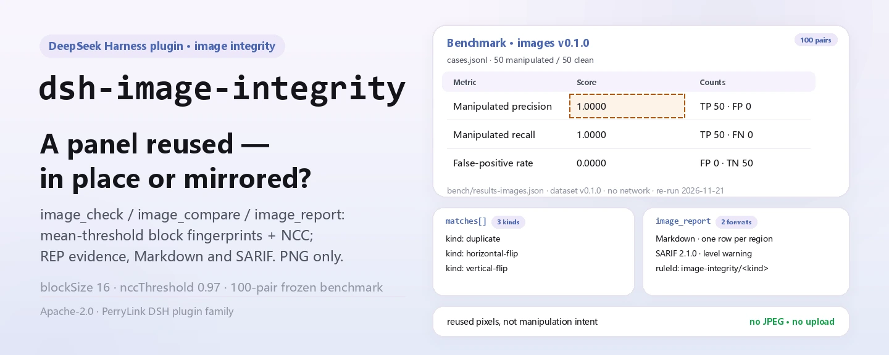

<div align="center">

<picture>
  <source media="(prefers-color-scheme: dark)" srcset="docs/assets/dsh-image-integrity-hero-en-dark.webp">
  
</picture>

# dsh-image-integrity

**¿Ese panel está reutilizado — duplicado en el sitio, o pegado espejado desde otra figura?**

*Decodificación PNG sin dependencias, huellas de bloques por umbral de media con confirmación NCC, informes de regiones duplicadas/espejadas, evidencia REP y SARIF. Encuentra píxeles reutilizados, no intención de manipulación.*

[English](README.md) · [简体中文](README-zh.md) · [Español](README-es.md) · [Português](README-pt.md) · [हिन्दी](README-hi.md)

[](LICENSE)
[]()

</div>

---

## Qué hace

- **`image_check`** — encuentra un bloque con textura que aparece dos veces (o espejado) dentro de una misma imagen.
- **`image_compare`** — encuentra bloques compartidos entre dos imágenes, incluidas las copias espejadas.
- **`image_report`** — Markdown + SARIF 2.1.0, una advertencia por región coincidente con coordenadas, distancia de Hamming y NCC.

Cómo funciona: decodificar PNG → luma → bloques de 16×16 → patrón de bits por umbral de media (robusto a desplazamientos de brillo) + confirmación NCC de media cero. Los bloques planos **o cercanos a un plano ajustado** se omiten, así que un degradado suave no se informa como "duplicado".

<picture>
  <source media="(prefers-color-scheme: dark)" srcset="docs/assets/dsh-image-integrity-flow-v5-dark.svg">
  
</picture>

*Estructura: decodificar → huella → coincidir; `matches[]` y el `analysis` derivado son las dos salidas, y cada coincidencia lleva sus coordenadas, tipo, distancia de Hamming y NCC. Las etiquetas de token del diagrama son los nombres de campo y valores por defecto reales, así que la misma imagen sirve para los cinco idiomas.*

## Lo que no hace

- **Sin JPEG.** Solo se decodifica PNG de 8 bits no entrelazado (gris/RGB/RGBA). JPEG/16 bits/entrelazado se rechazan con un código claro — sin basura silenciosa.
- **Sin alineación.** Las imágenes deben tener dimensiones idénticas; un desajuste se informa, nunca se redimensiona.
- **Sin robustez a desenfoque/compresión.** La recompresión JPEG, el escalado, la rotación o la mezcla de empalmes normalmente lo vencen.
- **Sin acusación de mala conducta.** Los controles repetidos, las barras de escala, los iconos y la textura de fondo son bloques compartidos legítimos. El informe lo dice.
- **Sin GUI, sin subida.** Solo bytes locales.

## Herramientas

### `image_check`

`{ path, persist?, blockSize?, maxShiftBits?, minVariance?, nccThreshold? }` → `{ ok, analysis, evidenceId?, recordPath? }`.

### `image_compare`

`{ pathA, pathB, persist?, ...thresholds }` → `{ ok, analysis, evidenceId?, recordPath? }`.

### `image_report`

`{ analysis, imageId? }` → `{ ok, markdown, sarif }`.

### Códigos de error

`INVALID_INPUT` · `NOT_FOUND` · `PATH_ESCAPE` · `NOT_A_FILE` · `TOO_LARGE` · `UNSUPPORTED_IMAGE` · `STORE_ERROR`

## Compatibilidad e instalación

| | |
|---|---|
| DeepSeek Harness | **`dsh-v0.2.2-rc.4`** (verificado 2026-11-18); peer `>=0.2.1-0 <0.3.0 \|\| >=0.2.2-0 <0.3.0` |
| Node | `^22.19.0 \|\| >=24.9.0` (probado en `24.22.1`), solo ESM |
| Peers | `@perrylink/dsh-research-core ^0.1.0`, `@deepseek-ai/cordis ^4.0.5-alpha.1`, `@deepseek-ai/dsh-tools`, `@deepseek-ai/schemastery ^3.18.5-alpha.1` |
| Dependencias en tiempo de ejecución | **cero** (PNG mediante `node:zlib`) |

```sh
dsh plugin --profile <name> add @perrylink/dsh-research-core dsh-image-integrity
dsh --profile <name> --dump-config | grep dsh-image-integrity
```

## Configuración

| Clave | Valor por defecto | Significado |
|---|---|---|
| `enabled` | `true` | `false` no monta nada |
| `root` | `.image-integrity` | raíz del store y de los registros |
| `workspaceRoot` | `process.cwd()` | las rutas deben resolverse dentro de ella |
| `maxBytes` | `20971520` | límite de archivo (falla, nunca trunca) |
| `maxPixels` | `4000000` | límite de píxeles decodificados |
| `persist` | `true` | guarda las imágenes como evidencia REP + registro |
| `blockSize` / `maxShiftBits` | `16` / `6` | lado del bloque (2–256); tolerancia de bits (0–blockSize²) |
| `minVariance` / `nccThreshold` | `6` / `0.97` | umbral de textura; confirmación NCC |

## Límites de seguridad

- Solo lectura sobre las imágenes; escribe solo bajo `root`.
- La contención por `realpath` rechaza los escapes por enlace simbólico.
- Topes duros de bytes y píxeles; el tope de píxeles se comprueba en el IHDR
  **antes** de inflar, y `inflateSync` está acotado por el tamaño de salida
  esperado. Las fallas son ruidosas.
- Los umbrales por llamada se validan (`blockSize` 2–256, `maxShiftBits`
  0–blockSize², NCC 0–1); un umbral inválido es `INVALID_INPUT`, no un crash.
- El parser PNG comprueba los límites de cada chunk; los formatos no soportados se rechazan, no se adivinan.

## Evaluación


*Animado: la salida real de `pnpm test` y el stdout real de `pnpm run bench:images` el 2026-11-21 (`BENCH_DIR` apuntando al checkout de `dsh-research-bench`; conjunto sintético congelado de 100 pares, sin red). Las marcas de aprobado se omiten porque la fuente del terminal no tiene ese glifo; los nombres de archivo, los conteos y las filas del benchmark son literales.*

**23 tests**: ida y vuelta PNG, rechazo de no-PNG / 16 bits / truncado, rechazo por tope de píxeles desde el IHDR antes de inflar (configurado y por defecto), primitivas de Hamming y NCC, detección de bloques duplicados, detección de espejo horizontal, controles de falsos positivos en imagen plana y en degradado, tamaño de bloque efectivo en imágenes pequeñas, emparejamiento entre dos imágenes, rechazo por dimensiones distintas, runtime (registro REP válido, dos instantáneas por comparación, rechazo de traversal/JPEG/exceso de bytes y píxeles, rechazo de umbrales inválidos), tools (esquemas, check→report, compare, informe malformado, rama de fallo), contrato de montaje (deshabilitado no monta nada, habilitado registra tres herramientas únicas) y contrato del paquete.

**Benchmark — 100 pares sintéticos.** `pnpm run bench:images` puntúa el plugin contra el conjunto congelado (versión del dataset 0.1.0) del repositorio compañero [`dsh-research-bench`](https://github.com/PerryLink/dsh-research-bench) (`data/images`): 25 pares duplicate + 25 flip + 25 unrelated + 25 hard-negative de PNG grises de 8 bits de 64×64, semilla fija, con los positivos copiando bloques de 16×16 alineados a la cuadrícula. El adaptador se ejecuta contra el `lib/` compilado, escribe [`bench/results-images.json`](bench/results-images.json) sin marcas de tiempo (repetirlo sobre los mismos datos produce bytes idénticos) y lee por defecto un checkout hermano `../dsh-research-bench`. Usa `BENCH_DIR` o `node bench/run-images.mjs --data <dir>` para otra ubicación.

| Métrica (50 manipuladas / 50 limpias) | Valor |
|---|---|
| Manipulated precision | 1.0000 |
| Manipulated recall | 1.0000 |
| Manipulated F1 | 1.0000 |
| Tasa de falsos positivos (unrelated + hard-negative) | 0.0000 |
| Subtype recall — duplicate | 1.0000 |
| Subtype recall — flip (horizontal 13 / vertical 12) | 1.0000 |

Confusión: TP 50, FP 0, TN 50, FN 0; ningún par se clasificó mal. La exactitud por categoría es 1.0000 en las cuatro categorías (25/25 cada una). Alcance: los positivos copian bloques de 16×16 **alineados a la cuadrícula**, es decir, la propia unidad del detector; los desplazamientos sub-bloque, la recompresión JPEG, el escalado y la rotación quedan fuera de este conjunto y siguen siendo limitaciones documentadas. Son números sintéticos sobre un fixture congelado, no una afirmación sobre con qué frecuencia las figuras reales reutilizan paneles. El dataset y el generador viven en el repositorio compañero y no se publican con este paquete.

## Limitaciones conocidas (v0.1)

- Solo PNG; sin JPEG/WebP/TIFF.
- Sin robustez a escalado/rotación/recompresión.
- La cuadrícula de bloques está alineada con los ejes; una región duplicada desplazada unos píxeles puede pasar desapercibida.
- Sin análisis de canales de color ni de metadatos (EXIF).

## Licencia

Apache-2.0. Sin código de terceros en tiempo de ejecución.
