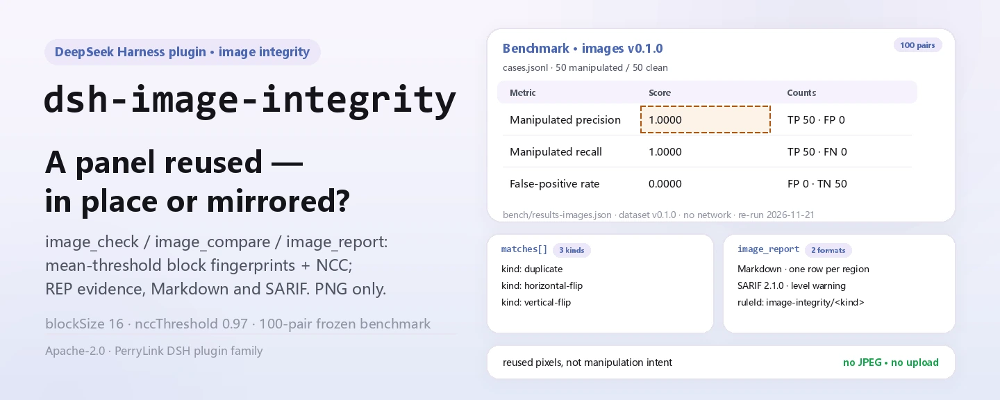
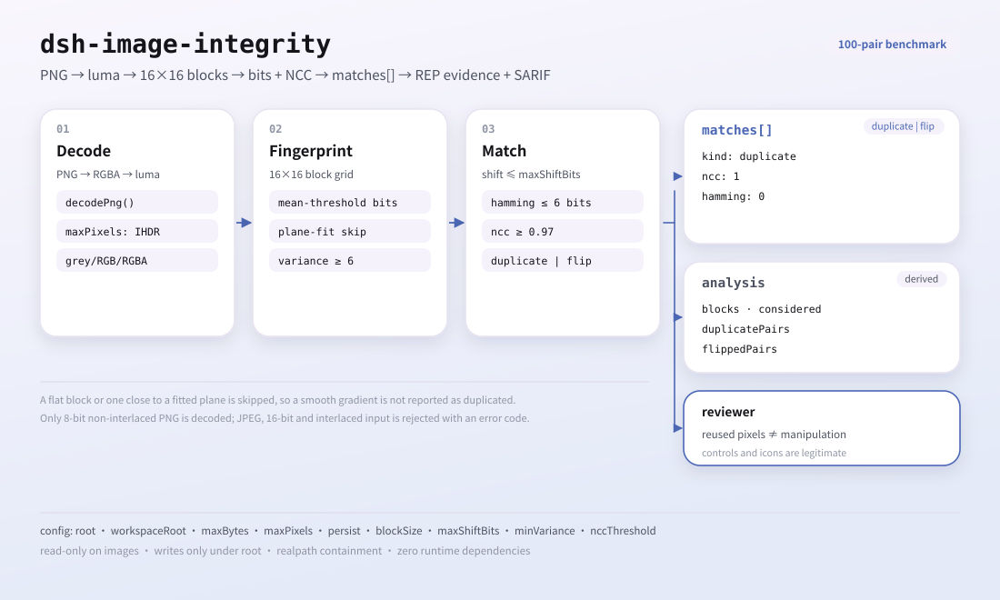

<div align="center">

<picture>
  <source media="(prefers-color-scheme: dark)" srcset="docs/assets/dsh-image-integrity-hero-en-dark.webp">
  
</picture>

# dsh-image-integrity

**क्या वह पैनल दोबारा इस्तेमाल हुआ है — जगह पर ही डुप्लिकेट, या किसी दूसरी आकृति से दर्पण में चिपकाया गया?**

*बिना निर्भरता वाला PNG डिकोडिंग, NCC पुष्टि के साथ माध्य-सीमा ब्लॉक फ़िंगरप्रिंट, डुप्लिकेट/दर्पण क्षेत्र रिपोर्ट, REP एविडेंस और SARIF। यह दोबारा इस्तेमाल किए गए पिक्सेल ढूँढता है, हेरफेर का इरादा नहीं।*

[English](README.md) · [简体中文](README-zh.md) · [Español](README-es.md) · [Português](README-pt.md) · [हिन्दी](README-hi.md)

[](LICENSE)
[]()

</div>

---

## यह क्या करता है

- **`image_check`** — एक ही छवि के भीतर दो बार (या दर्पण रूप में) दिखने वाला बनावटी ब्लॉक ढूँढता है।
- **`image_compare`** — दो छवियों के बीच साझा ब्लॉक ढूँढता है, दर्पण प्रतियों सहित।
- **`image_report`** — Markdown + SARIF 2.1.0, हर मिले क्षेत्र के लिए एक चेतावनी, निर्देशांक, हैमिंग दूरी और NCC के साथ।

कैसे काम करता है: PNG डिकोड → luma → 16×16 ब्लॉक → माध्य-सीमा बिट पैटर्न (चमक के अंतर के प्रति मज़बूत) + शून्य-माध्य NCC पुष्टि। सपाट **या किसी फ़िट किए गए तल के करीब** वाले ब्लॉक छोड़ दिए जाते हैं, इसलिए चिकनी ग्रेडिएंट "डुप्लिकेट" नहीं बताई जाती।

<picture>
  <source media="(prefers-color-scheme: dark)" srcset="docs/assets/dsh-image-integrity-flow-v5-dark.svg">
  
</picture>

*संरचना: डिकोड → फ़िंगरप्रिंट → मिलान; `matches[]` और उससे व्युत्पन्न `analysis` दो आउटपुट हैं, और हर मैच अपने निर्देशांक, प्रकार, हैमिंग दूरी और NCC के साथ आता है। डायग्राम के टोकन लेबल असली फ़ील्ड नाम और डिफ़ॉल्ट हैं, इसलिए एक ही चित्र पाँचों भाषाओं के लिए काम आता है।*

## यह क्या नहीं करता

- **JPEG नहीं।** केवल 8-बिट गैर-इंटरलेस्ड PNG (ग्रे/RGB/RGBA) डिकोड होता है। JPEG/16-बिट/इंटरलेस्ड स्पष्ट कोड के साथ अस्वीकार होते हैं — कोई चुपचाप कचरा नहीं।
- **संरेखण नहीं।** छवियों के आयाम बिल्कुल समान होने चाहिए; असंगति रिपोर्ट होती है, कभी रीसाइज़ नहीं।
- **धुँधलापन/कंप्रेशन के प्रति मज़बूती नहीं।** JPEG रीकंप्रेशन, स्केलिंग, रोटेशन या स्प्लाइस ब्लेंडिंग आमतौर पर इसे हरा देते हैं।
- **कदाचार का आरोप नहीं।** दोहराए गए कंट्रोल, स्केल बार, आइकन और बैकग्राउंड बनावट वैध साझा ब्लॉक हैं। रिपोर्ट यह बताती है।
- **कोई GUI नहीं, कोई अपलोड नहीं।** केवल स्थानीय बाइट्स।

## टूल

### `image_check`

`{ path, persist?, blockSize?, maxShiftBits?, minVariance?, nccThreshold? }` → `{ ok, analysis, evidenceId?, recordPath? }`.

### `image_compare`

`{ pathA, pathB, persist?, ...thresholds }` → `{ ok, analysis, evidenceId?, recordPath? }`.

### `image_report`

`{ analysis, imageId? }` → `{ ok, markdown, sarif }`.

### त्रुटि कोड

`INVALID_INPUT` · `NOT_FOUND` · `PATH_ESCAPE` · `NOT_A_FILE` · `TOO_LARGE` · `UNSUPPORTED_IMAGE` · `STORE_ERROR`

## संगतता और इंस्टॉल

| | |
|---|---|
| DeepSeek Harness | **`dsh-v0.2.3-alpha.1`** (2026-11-22 को सत्यापित); peer `>=0.2.1-0 <0.3.0 \|\| >=0.2.2-0 <0.3.0` |
| Node | `^22.19.0 \|\| >=24.9.0` (`24.22.1` पर परीक्षित), केवल ESM |
| Peers | `@perrylink/dsh-research-core ^0.1.0`, `@deepseek-ai/cordis ^4.0.5-alpha.1`, `@deepseek-ai/dsh-tools`, `@deepseek-ai/schemastery ^3.18.5-alpha.1` |
| रनटाइम निर्भरताएँ | **शून्य** (`node:zlib` से PNG) |

```sh
dsh plugin --profile <name> add @perrylink/dsh-research-core dsh-image-integrity
dsh --profile <name> --dump-config | grep dsh-image-integrity
```

## कॉन्फ़िगरेशन

| कुंजी | डिफ़ॉल्ट | अर्थ |
|---|---|---|
| `enabled` | `true` | `false` कुछ भी माउंट नहीं करता |
| `root` | `.image-integrity` | store/रिकॉर्ड की जड़ |
| `workspaceRoot` | `process.cwd()` | रास्ते इसके भीतर हल होने चाहिए |
| `maxBytes` | `20971520` | फ़ाइल सीमा (विफल होती है, कभी काटती नहीं) |
| `maxPixels` | `4000000` | डिकोड किए गए पिक्सेल की सीमा |
| `persist` | `true` | छवियों को REP एविडेंस + रिकॉर्ड के रूप में सहेजता है |
| `blockSize` / `maxShiftBits` | `16` / `6` | ब्लॉक भुजा (2–256); बिट सहनशीलता (0–blockSize²) |
| `minVariance` / `nccThreshold` | `6` / `0.97` | बनावट की निचली सीमा; NCC पुष्टि |

## सुरक्षा सीमाएँ

- छवियों पर केवल पढ़ता है; लिखता केवल `root` के नीचे है।
- `realpath` कंटेनमेंट सिमलिंक एस्केप अस्वीकार करता है।
- बाइट्स और पिक्सेल पर कड़ी सीमाएँ; पिक्सेल सीमा इन्फ़्लेट से **पहले** IHDR से जाँची जाती है,
  और `inflateSync` अपेक्षित आउटपुट आकार तक सीमित है। विफलताएँ ज़ोरदार हैं।
- प्रति-कॉल थ्रेशोल्ड मान्य होते हैं (`blockSize` 2–256, `maxShiftBits` 0–blockSize², NCC 0–1);
  अमान्य थ्रेशोल्ड `INVALID_INPUT` है, क्रैश नहीं।
- PNG पार्सर हर chunk की सीमाएँ जाँचता है; असमर्थित फ़ॉर्मैट अस्वीकार होते हैं, अनुमान नहीं।

## मूल्यांकन


*एनिमेटेड: 2026-11-21 को `pnpm test` का असली आउटपुट और `pnpm run bench:images` का असली stdout (`BENCH_DIR` `dsh-research-bench` चेकआउट की ओर; फ़्रोज़न 100-जोड़ों वाला सिंथेटिक डेटासेट, कोई नेटवर्क नहीं)। पास-मार्कर छोड़े गए हैं क्योंकि टर्मिनल फ़ॉन्ट में वह ग्लिफ़ नहीं है; फ़ाइल नाम, गिनतियाँ और बेंचमार्क पंक्तियाँ शब्दशः हैं।*

**23 टेस्ट**: PNG राउंड-ट्रिप, गैर-PNG / 16-बिट / कटे हुए का अस्वीकार, इन्फ़्लेट से पहले IHDR से पिक्सेल-सीमा अस्वीकार (कॉन्फ़िगर और डिफ़ॉल्ट), हैमिंग और NCC प्रिमिटिव, डुप्लिकेट ब्लॉक पहचान, क्षैतिज दर्पण पहचान, सपाट छवि और ग्रेडिएंट पर false-positive नियंत्रण, छोटी छवि में प्रभावी ब्लॉक आकार, जोड़ी मिलान, आयाम-असंगति पर इनकार, runtime (वैध REP रिकॉर्ड, प्रति तुलना दो स्नैपशॉट, traversal/JPEG/बाइट-और-पिक्सेल अधिकता का अस्वीकार, अमान्य थ्रेशोल्ड का अस्वीकार), tools (स्कीमा, check→report, compare, विकृत रिपोर्ट, विफलता शाखा), माउंट कॉन्ट्रैक्ट (disabled कुछ माउंट नहीं करता, enabled तीन अद्वितीय टूल पंजीकृत करता है), पैकेज कॉन्ट्रैक्ट।

**बेंचमार्क — 100 सिंथेटिक जोड़े।** `pnpm run bench:images` साथी रिपॉज़िटरी [`dsh-research-bench`](https://github.com/PerryLink/dsh-research-bench) (डेटासेट संस्करण 0.1.0, `data/images`) के फ़्रोज़न सेट पर प्लगइन को स्कोर करता है: 64×64 8-बिट ग्रे PNG के 25 duplicate + 25 flip + 25 unrelated + 25 hard-negative जोड़े, निश्चित सीड, जहाँ सकारात्मक जोड़े ग्रिड-संरेखित 16×16 ब्लॉक कॉपी करते हैं। एडाप्टर बिल्ड किए गए `lib/` के विरुद्ध चलता है, [`bench/results-images.json`](bench/results-images.json) बिना टाइमस्टैम्प के लिखता है (उसी डेटा पर दोबारा चलाने पर बाइट-समान), और डिफ़ॉल्ट रूप से सहोदर `../dsh-research-bench` चेकआउट पढ़ता है। दूसरी जगह के लिए `BENCH_DIR` सेट करें या `node bench/run-images.mjs --data <dir>` दें।

| मीट्रिक (50 manipulated / 50 clean) | मान |
|---|---|
| Manipulated precision | 1.0000 |
| Manipulated recall | 1.0000 |
| Manipulated F1 | 1.0000 |
| False-positive दर (unrelated + hard-negative) | 0.0000 |
| Subtype recall — duplicate | 1.0000 |
| Subtype recall — flip (horizontal 13 / vertical 12) | 1.0000 |

कन्फ़्यूज़न: TP 50, FP 0, TN 50, FN 0; कोई भी जोड़ा गलत वर्गीकृत नहीं हुआ। चारों श्रेणियों में प्रति-श्रेणी सटीकता 1.0000 है (हर एक में 25/25)। दायरा: सकारात्मक जोड़े **ग्रिड-संरेखित** 16×16 ब्लॉक कॉपी करते हैं, यानी डिटेक्टर की अपनी इकाई; सब-ग्रिड शिफ़्ट, JPEG रीकंप्रेशन, स्केलिंग और रोटेशन इस सेट से बाहर हैं और दर्ज सीमाएँ बनी हुई हैं। ये एक फ़्रोज़न फ़िक्स्चर पर सिंथेटिक संख्याएँ हैं, यह दावा नहीं कि असली आकृतियाँ कितनी बार पैनल दोबारा इस्तेमाल करती हैं। डेटासेट और जनरेटर साथी रिपॉज़िटरी में रहते हैं और इस पैकेज के साथ प्रकाशित नहीं होते।

## ज्ञात सीमाएँ (v0.1)

- केवल PNG; JPEG/WebP/TIFF नहीं।
- स्केलिंग/रोटेशन/रीकंप्रेशन के प्रति मज़बूती नहीं।
- ब्लॉक ग्रिड अक्ष-संरेखित है; कुछ पिक्सेल खिसका दोहराया क्षेत्र छूट सकता है।
- रंग-चैनल या मेटाडेटा (EXIF) विश्लेषण नहीं।

## लाइसेंस

Apache-2.0. रनटाइम में कोई तृतीय-पक्ष कोड नहीं।
