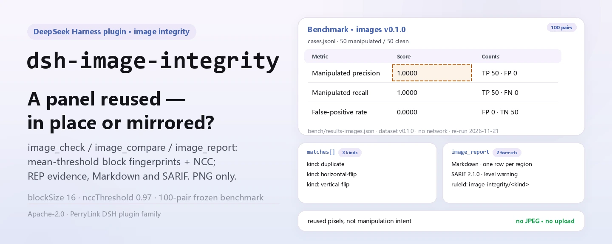
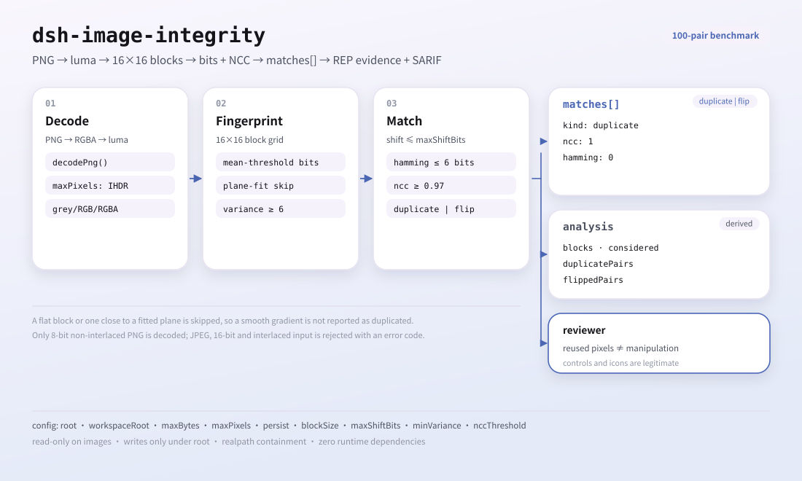

<div align="center">

<picture>
  <source media="(prefers-color-scheme: dark)" srcset="docs/assets/dsh-image-integrity-hero-en-dark.webp">
  
</picture>

# dsh-image-integrity

**Aquele painel foi reutilizado — duplicado no lugar, ou colado espelhado de outra figura?**

*Decodificação PNG sem dependências, impressões digitais de blocos por limiar de média com confirmação NCC, relatórios de regiões duplicadas/espelhadas, evidência REP e SARIF. Ele encontra pixels reutilizados, não intenção de manipulação.*

[English](README.md) · [简体中文](README-zh.md) · [Español](README-es.md) · [Português](README-pt.md) · [हिन्दी](README-hi.md)

[](LICENSE)
[]()

</div>

---

## O que ele faz

- **`image_check`** — encontra um bloco com textura que aparece duas vezes (ou espelhado) dentro de uma mesma imagem.
- **`image_compare`** — encontra blocos compartilhados entre duas imagens, incluindo cópias espelhadas.
- **`image_report`** — Markdown + SARIF 2.1.0, um aviso por região correspondente com coordenadas, distância de Hamming e NCC.

Como funciona: decodificar PNG → luma → blocos de 16×16 → padrão de bits por limiar de média (robusto a deslocamentos de brilho) + confirmação NCC de média zero. Blocos planos **ou próximos de um plano ajustado** são pulados, então um gradiente suave não é reportado como "duplicado".

<picture>
  <source media="(prefers-color-scheme: dark)" srcset="docs/assets/dsh-image-integrity-flow-v5-dark.svg">
  
</picture>

*Estrutura: decodificar → impressão digital → corresponder; `matches[]` e o `analysis` derivado são as duas saídas, e cada correspondência carrega suas coordenadas, tipo, distância de Hamming e NCC. Os rótulos de token do diagrama são os nomes de campo e padrões reais, então a mesma imagem serve aos cinco idiomas.*

## O que ele não faz

- **Sem JPEG.** Apenas PNG de 8 bits não entrelaçado (cinza/RGB/RGBA) é decodificado. JPEG/16 bits/entrelaçado são rejeitados com um código claro — nada de lixo silencioso.
- **Sem alinhamento.** As imagens devem ter dimensões idênticas; uma divergência é reportada, nunca redimensionada.
- **Sem robustez a desfoque/compressão.** Recompressão JPEG, escala, rotação ou mistura de emendas normalmente vencem a detecção.
- **Sem acusação de má conduta.** Controles repetidos, barras de escala, ícones e textura de fundo são blocos compartilhados legítimos. O relatório diz isso.
- **Sem GUI, sem upload.** Apenas bytes locais.

## Ferramentas

### `image_check`

`{ path, persist?, blockSize?, maxShiftBits?, minVariance?, nccThreshold? }` → `{ ok, analysis, evidenceId?, recordPath? }`.

### `image_compare`

`{ pathA, pathB, persist?, ...thresholds }` → `{ ok, analysis, evidenceId?, recordPath? }`.

### `image_report`

`{ analysis, imageId? }` → `{ ok, markdown, sarif }`.

### Códigos de erro

`INVALID_INPUT` · `NOT_FOUND` · `PATH_ESCAPE` · `NOT_A_FILE` · `TOO_LARGE` · `UNSUPPORTED_IMAGE` · `STORE_ERROR`

## Compatibilidade e instalação

| | |
|---|---|
| DeepSeek Harness | **`dsh-v0.2.3-alpha.1`** (verificado em 2026-11-22); peer `>=0.2.1-0 <0.3.0 \|\| >=0.2.2-0 <0.3.0` |
| Node | `^22.19.0 \|\| >=24.9.0` (testado em `24.22.1`), apenas ESM |
| Peers | `@perrylink/dsh-research-core ^0.1.0`, `@deepseek-ai/cordis ^4.0.5-alpha.1`, `@deepseek-ai/dsh-tools`, `@deepseek-ai/schemastery ^3.18.5-alpha.1` |
| Dependências de runtime | **zero** (PNG via `node:zlib`) |

```sh
dsh plugin --profile <name> add @perrylink/dsh-research-core dsh-image-integrity
dsh --profile <name> --dump-config | grep dsh-image-integrity
```

## Configuração

| Chave | Valor padrão | Significado |
|---|---|---|
| `enabled` | `true` | `false` não monta nada |
| `root` | `.image-integrity` | raiz do store e dos registros |
| `workspaceRoot` | `process.cwd()` | os caminhos devem resolver dentro dela |
| `maxBytes` | `20971520` | teto de arquivo (falha, nunca trunca) |
| `maxPixels` | `4000000` | teto de pixels decodificados |
| `persist` | `true` | guarda as imagens como evidência REP + registro |
| `blockSize` / `maxShiftBits` | `16` / `6` | lado do bloco (2–256); tolerância de bits (0–blockSize²) |
| `minVariance` / `nccThreshold` | `6` / `0.97` | piso de textura; confirmação NCC |

## Limites de segurança

- Somente leitura nas imagens; grava apenas sob `root`.
- A contenção por `realpath` rejeita escapes por link simbólico.
- Tetos rígidos de bytes e pixels; o teto de pixels é checado no IHDR
  **antes** de inflar, e o `inflateSync` é limitado pelo tamanho de saída
  esperado. As falhas são ruidosas.
- Os limiares por chamada são validados (`blockSize` 2–256, `maxShiftBits`
  0–blockSize², NCC 0–1); um limiar inválido é `INVALID_INPUT`, não um crash.
- O parser PNG checa os limites de cada chunk; formatos não suportados são rejeitados, não adivinhados.

## Avaliação


*Animado: a saída real de `pnpm test` e o stdout real de `pnpm run bench:images` em 2026-11-21 (`BENCH_DIR` apontando para o checkout do `dsh-research-bench`; conjunto sintético congelado de 100 pares, sem rede). As marcas de aprovação são omitidas porque a fonte do terminal não tem esse glifo; os nomes de arquivo, as contagens e as linhas do benchmark são literais.*

**23 testes**: ida e volta PNG, rejeição de não-PNG / 16 bits / truncado, rejeição por teto de pixels a partir do IHDR antes de inflar (configurado e padrão), primitivas de Hamming e NCC, detecção de blocos duplicados, detecção de espelho horizontal, controles de falsos positivos em imagem plana e em gradiente, tamanho de bloco efetivo em imagens pequenas, emparelhamento entre duas imagens, recusa por dimensões diferentes, runtime (registro REP válido, dois snapshots por comparação, rejeição de traversal/JPEG/excesso de bytes e pixels, rejeição de limiares inválidos), tools (esquemas, check→report, compare, relatório malformado, ramo de falha), contrato de montagem (desabilitado não monta nada, habilitado registra três ferramentas únicas) e contrato do pacote.

**Benchmark — 100 pares sintéticos.** `pnpm run bench:images` pontua o plugin contra o conjunto congelado (versão do dataset 0.1.0) no repositório companheiro [`dsh-research-bench`](https://github.com/PerryLink/dsh-research-bench) (`data/images`): 25 pares duplicate + 25 flip + 25 unrelated + 25 hard-negative de PNGs cinza de 8 bits de 64×64, semente fixa, com os positivos copiando blocos de 16×16 alinhados à grade. O adaptador roda contra o `lib/` compilado, grava [`bench/results-images.json`](bench/results-images.json) sem timestamps (rodar de novo sobre os mesmos dados gera bytes idênticos) e lê por padrão um checkout irmão `../dsh-research-bench`. Use `BENCH_DIR` ou `node bench/run-images.mjs --data <dir>` para outro local.

| Métrica (50 manipuladas / 50 limpas) | Valor |
|---|---|
| Manipulated precision | 1.0000 |
| Manipulated recall | 1.0000 |
| Manipulated F1 | 1.0000 |
| Taxa de falsos positivos (unrelated + hard-negative) | 0.0000 |
| Subtype recall — duplicate | 1.0000 |
| Subtype recall — flip (horizontal 13 / vertical 12) | 1.0000 |

Confusão: TP 50, FP 0, TN 50, FN 0; nenhum par foi classificado errado. A acurácia por categoria é 1.0000 nas quatro categorias (25/25 cada). Escopo: os positivos copiam blocos de 16×16 **alinhados à grade**, ou seja, a própria unidade do detector; deslocamentos sub-bloco, recompressão JPEG, escala e rotação ficam fora deste conjunto e continuam limitações documentadas. São números sintéticos sobre um fixture congelado, não uma afirmação sobre com que frequência figuras reais reutilizam painéis. O dataset e o gerador vivem no repositório companheiro e não são publicados com este pacote.

## Limitações conhecidas (v0.1)

- Somente PNG; sem JPEG/WebP/TIFF.
- Sem robustez a escala/rotação/recompressão.
- A grade de blocos é alinhada aos eixos; uma região duplicada deslocada alguns pixels pode passar despercebida.
- Sem análise de canais de cor ou de metadados (EXIF).

## Licença

Apache-2.0. Sem código de terceiros em runtime.
